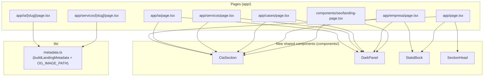

# Design Document

## Overview

This refactoring eliminates copy-pasted code across the UNIDAX Next.js 15 site by extracting six recurring patterns into reusable Server Components and a pure TypeScript helper. No user-facing behaviour changes; the goal is a single source of truth for each pattern so future edits propagate automatically.

**Scope summary**

| Deliverable | File | Pattern extracted |
|---|---|---|
| `CtaSection` | `components/cta-section.tsx` | Red CTA section (`section.cta`) |
| `DarkPanel` | `components/dark-panel.tsx` | Dark editorial section (`section.dark-panel`) |
| `StatsBlock` | `components/stats-block.tsx` | Stats grid (`.stats`) |
| `SectionHead` | `components/section-head.tsx` | Section header with optional link |
| `buildLandingMetadata` | `lib/metadata.ts` | `generateMetadata` body for landing pages |
| `OG_IMAGE_PATH` | `lib/metadata.ts` | OG image URL constant |

All new files are **Server Components** (no `"use client"`), use named exports, and import via the `@/` alias. No new `npm` dependencies are introduced. `app/globals.css` is untouched.

---

## Architecture

The refactoring fits entirely within the existing Next.js App Router architecture. No routing changes, no new data-fetching layers, no additions to `lib/cms.ts` or `lib/content.ts`.



**Data flow** is unchanged: pages still read from `lib/cms.ts` (which falls back to `lib/content.ts`). The new components receive data as props; they never fetch.

---

## Components and Interfaces

### 1. `CtaSection` — `components/cta-section.tsx`

Encapsulates the red CTA band (`section.cta`) that currently appears inline on five pages and in `components/seo/landing-page.tsx`.

```typescript
import Link from "next/link";
import { ArrowIcon } from "@/components/icons";

interface CtaSectionProps {
  title: string;
  text: string;
  /** @default "/contato" */
  href?: string;
  /** @default "Falar com um especialista" */
  label?: string;
  /** Optional extra content rendered below the text (e.g. cta-note div) */
  children?: React.ReactNode;
}

export function CtaSection({
  title,
  text,
  href = "/contato",
  label = "Falar com um especialista",
  children,
}: CtaSectionProps): JSX.Element
```

**Rendered HTML structure** (mirrors all inline occurrences):

```html
<section class="cta">
  <div class="container cta-grid">
    <div>
      <h2>{title}</h2>
      <p>{text}</p>
      {children}            <!-- slot for cta-note or extra markup -->
    </div>
    <a class="btn btn-light" href="{href}">
      {label} <ArrowIcon />
    </a>
  </div>
</section>
```

**Usage notes**

- `app/page.tsx` passes a `children` slot for the `<div className="cta-note">` paragraph unique to the homepage.
- `components/seo/landing-page.tsx` passes a dynamic `href` (`/contato?interesse=…`) and a dynamic `label` (`item.cta`).
- All other pages use default values for `href` and `label`.

---

### 2. `DarkPanel` — `components/dark-panel.tsx`

Encapsulates the dark editorial section (`section.section.dark-panel`). Used across `app/ia/page.tsx` (two instances), `app/servicos/page.tsx`, `app/cases/page.tsx`, `app/empresa/page.tsx`, and `components/seo/landing-page.tsx`.

```typescript
import { Reveal } from "@/components/reveal";

interface DarkPanelProps {
  /** Eyebrow label. Rendered with class "eyebrow light". */
  eyebrow?: string;
  title: string;
  children: React.ReactNode;
  /** Additional className appended to the outer <section> */
  className?: string;
}

export function DarkPanel({
  eyebrow,
  title,
  children,
  className,
}: DarkPanelProps): JSX.Element
```

**Rendered HTML structure:**

```html
<section class="section dark-panel {className}">
  <div class="container">
    <Reveal>
      {eyebrow && <div class="eyebrow light">{eyebrow}</div>}
      <h2>{title}</h2>
      {children}
    </Reveal>
  </div>
</section>
```

**Usage notes**

- `app/ia/page.tsx` has two dark panels: `#metodologia` (with `id="metodologia"`) and `#ai-first` (with class `ia-aifirst`). Both use `className` to pass these extra identifiers.
- The `Reveal` wrapper is built into `DarkPanel`; callers do **not** need to add their own `<Reveal>` around the top-level heading block.
- Content below the heading (`children`) may itself contain additional `<Reveal>` wrappers if needed.

---

### 3. `StatsBlock` — `components/stats-block.tsx`

Encapsulates the `.stats` grid. Currently duplicated in `app/page.tsx` and `app/empresa/page.tsx`.

```typescript
interface StatsBlockProps {
  items: ReadonlyArray<readonly [string, string]>;
  /**
   * When true, applies borderLeft:0 to the .stats container.
   * Used in app/empresa/page.tsx where the grid sits on a white background.
   * @default false
   */
  borderless?: boolean;
}

export function StatsBlock({
  items,
  borderless = false,
}: StatsBlockProps): JSX.Element
```

**Rendered HTML structure:**

```html
<div class="stats" style="border-left: 0" | undefined>
  <div class="stat">
    <strong>{value}</strong>
    <span>{label}</span>
  </div>
  …
</div>
```

**Usage notes**

- `app/page.tsx` wraps the stats in a `<Reveal delay={100}>` — the caller keeps that wrapper; `StatsBlock` does not add one.
- `app/empresa/page.tsx` sets `borderless={true}`.
- The prop type `ReadonlyArray<readonly [string, string]>` is compatible with `typeof stats` from `lib/content.ts` (a `readonly` tuple array).

---

### 4. `SectionHead` — `components/section-head.tsx`

Encapsulates the `.section-head` header block used three times in `app/page.tsx` (IA services, Cases, Insights sections).

```typescript
import Link from "next/link";
import { ArrowIcon } from "@/components/icons";

interface SectionHeadProps {
  eyebrow: string;
  title: string;
  text: string;
  /** When provided, a link is rendered on the right. */
  linkLabel?: string;
  /** Required when linkLabel is set. */
  linkHref?: string;
}

export function SectionHead({
  eyebrow,
  title,
  text,
  linkLabel,
  linkHref,
}: SectionHeadProps): JSX.Element
```

**Rendered HTML structure:**

```html
<!-- With link -->
<div class="section-head">
  <div>
    <div class="eyebrow">{eyebrow}</div>
    <h2>{title}</h2>
    <p>{text}</p>
  </div>
  <a class="link" href="{linkHref}">
    {linkLabel} <ArrowIcon />
  </a>
</div>

<!-- Without link (linkLabel / linkHref omitted) -->
<div class="section-head">
  <div>
    <div class="eyebrow">{eyebrow}</div>
    <h2>{title}</h2>
    <p>{text}</p>
  </div>
</div>
```

**Usage notes**

- All three occurrences in `app/page.tsx` provide both `linkLabel` and `linkHref`.
- The component itself is not wrapped in `<Reveal>` — callers wrap it: `<Reveal><SectionHead …/></Reveal>`.

---

### 5. `buildLandingMetadata` — `lib/metadata.ts`

A pure TypeScript function (no JSX, no React). Replaces the identical inline `generateMetadata` bodies in `app/ia/[slug]/page.tsx` and `app/servicos/[slug]/page.tsx`.

```typescript
import type { Metadata } from "next";

/** Canonical path to the dynamic OG image route */
export const OG_IMAGE_PATH = "/opengraph-image";

interface LandingMetadataInput {
  title: string;
  description: string;
}

/**
 * Builds a Next.js Metadata object for SEO landing pages.
 *
 * @param item  - Object with title and description (subset of LandingContent)
 * @param url   - Full canonical URL, e.g. "https://www.unidax.com.br/ia/agentes-de-ia-para-empresas"
 */
export function buildLandingMetadata(
  item: LandingMetadataInput,
  url: string,
): Metadata
```

**Returned object shape:**

```typescript
{
  title: item.title,
  description: item.description,
  alternates: { canonical: url },
  openGraph: {
    type: "website",
    title: item.title,
    description: item.description,
    url,
    images: [{ url: OG_IMAGE_PATH }],
  },
  twitter: {
    card: "summary_large_image",
    title: item.title,
    description: item.description,
  },
}
```

**`OG_IMAGE_PATH` adoption**

Beyond the two landing-page routes, `app/insights/[slug]/page.tsx` and `app/cases/[slug]/page.tsx` also hardcode `"/opengraph-image"`. Per Requirement 6.1–6.2, all four pages import and reference `OG_IMAGE_PATH` after this refactoring. Those two pages do not use `buildLandingMetadata` (their metadata shapes differ), but they do import the constant.

---

## Data Models

No new data models are introduced. The relevant existing types remain unchanged:

| Type | Source | Notes |
|---|---|---|
| `LandingContent` | `lib/seo-content.ts` | Sole definition — no redefinition elsewhere (Req 6.3) |
| `Case` | `lib/content.ts` | Sole definition (Req 6.4) |
| `Insight` | `lib/content.ts` | Sole definition (Req 6.4) |
| `Metadata` | `next` | Imported, never redefined |

`lib/metadata.ts` depends only on `next` (for the `Metadata` type) — no new third-party packages (Req 4.5, 7.4).

---

## Error Handling

This refactoring involves no asynchronous operations, no network calls, and no runtime-variable data paths in the new components. Error-handling considerations are limited to:

1. **Missing `linkHref` with a supplied `linkLabel` in `SectionHead`**: TypeScript strict mode does not enforce co-presence of two optional props at the type level. The component should guard at runtime: if `linkLabel` is provided but `linkHref` is falsy, the link is simply omitted (same as if both were absent). A TypeScript overload or discriminated union is an alternative but would complicate the interface unnecessarily for this use case.

2. **`buildLandingMetadata` with an empty `url`**: The callers construct `url` from `site.url` (never empty in production) and a slug derived from `params`. No additional guard is needed beyond what already exists in the calling `generateMetadata` functions (the `if (!item) return {}` early-exit).

3. **`StatsBlock` with an empty `items` array**: renders an empty `<div class="stats">` — no error, no visible change. Acceptable.

4. **`DarkPanel` className concatenation**: `className` is appended with a space only if truthy, preventing a leading-space artifact in the DOM.

---

## Testing Strategy

Property-based testing is **not applicable** to this feature. The deliverables are:

- React Server Components that wrap existing JSX with props — best validated by render/snapshot tests.
- A pure function (`buildLandingMetadata`) whose output is a plain object — best validated by example-based unit tests.

There are no parsers, serializers, data transformations, or algorithms with a large meaningful input space.

### Unit tests — `buildLandingMetadata`

File: `lib/__tests__/metadata.test.ts`

Test cases (example-based):

1. **Returns correct title and description** — given `{ title: "T", description: "D" }` and a URL, the result has `title === "T"` and `description === "D"`.
2. **Sets alternates.canonical** — `result.alternates.canonical` equals the supplied URL.
3. **Sets openGraph fields** — `openGraph.type === "website"`, `openGraph.url` equals the supplied URL, `openGraph.images[0].url === OG_IMAGE_PATH`.
4. **Sets twitter card** — `twitter.card === "summary_large_image"`.
5. **OG_IMAGE_PATH constant** — `OG_IMAGE_PATH === "/opengraph-image"`.

### Snapshot / render tests — Server Components

File: `components/__tests__/cta-section.test.tsx`, `dark-panel.test.tsx`, `stats-block.test.tsx`, `section-head.test.tsx`

Each component gets:

- A **default-props render** test confirming the expected class names and heading text appear in the output.
- A **prop variation** test for each conditional branch (e.g. `borderless={true}` on `StatsBlock`, absent link on `SectionHead`, absent `eyebrow` on `DarkPanel`, custom `href`/`label` on `CtaSection`).

Use `@testing-library/react` with the `react-server` render mode (or a lightweight SSR renderer compatible with React 19 Server Components).

### Integration / build verification

Per Requirement 7.1–7.2, the pre-deploy sequence serves as the integration test suite:

```bash
npm run check:routes   # route file integrity
npm run typecheck      # tsc --noEmit, strict mode
npm run lint           # ESLint across app/, components/, lib/
npm run build          # Next.js production build
```

All four must exit 0 after the refactoring. No snapshot of rendered HTML is required beyond what `npm run build` validates statically.
