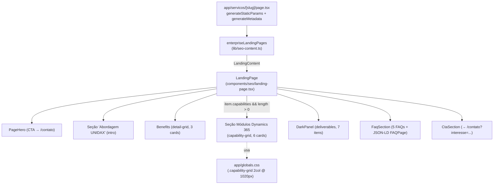

# Design Document — Enriquecimento da Página ERP e Microsoft Dynamics

## Overview

Este design descreve as mudanças necessárias para enriquecer a landing page `/servicos/erp-dynamics` com conteúdo específico sobre Microsoft Dynamics 365, cobrindo os módulos da plataforma no estilo consultivo da UNIDAX, expandindo entregáveis e FAQs, e garantindo responsividade correta da seção de capabilities em dispositivos móveis e tablets.

A mudança segue o mesmo padrão estabelecido no enriquecimento da página `/ia/desenvolvimento-de-sistemas-de-ia`: campo opcional, renderização condicional, CSS em `globals.css`. O único delta em relação àquela spec é a necessidade de tornar o eyebrow e o `<h2>` da seção capabilities configuráveis, pois os textos atuais ("Capacidades de IA" / "O que construímos em sistemas de IA.") não fazem sentido no contexto de ERP/Dynamics.

### Escopo

| Arquivo | Tipo de mudança |
|---|---|
| `lib/seo-content.ts` | Tipo `LandingContent`: 2 campos opcionais novos. Entrada `erp-dynamics`: todos os campos de conteúdo revisados/expandidos. |
| `components/seo/landing-page.tsx` | Substituir eyebrow/h2 hard-coded da seção capabilities por campos do item. |
| `app/globals.css` | Adicionar `.capability-grid` no bloco `@media (max-width:1020px)` existente. |

### Não alterado

Todos os demais arquivos permanecem intocados: `app/servicos/[slug]/page.tsx`, `components/page-hero.tsx`, `components/dark-panel.tsx`, `components/cta-section.tsx`, `components/seo/json-ld.tsx`, `components/reveal.tsx`, e todas as demais 8 landing pages (3 de IA + 5 de serviços).

### Decisões principais

| # | Decisão | Rationale |
|---|---|---|
| D1 | Eyebrow e h2 da seção capabilities tornam-se **campos opcionais** em `LandingContent` (`capabilitiesEyebrow?`, `capabilitiesTitle?`) | Opção A: segue o padrão `capabilities?` já estabelecido; zero acoplamento no componente; retrocompatível (páginas sem o campo continuam com os valores-padrão pt-BR hard-coded). Opção B (condicional por `kind`) acopla o componente a domínio de negócio. Opção C (hardcode ERP) quebraria a página de IA. |
| D2 | Fallback dos campos no componente: se ausentes, usar os textos existentes de IA | Mantém a página de IA 100% inalterada sem precisar declarar os novos campos. |
| D3 | CSS adicionado **dentro do bloco `@media (max-width:1020px)` já existente** | Req 6.3: sem novos blocos `@media`, sem novos arquivos CSS. `.detail-grid` em `max-width:700px` já cobre 1 coluna via herança. |
| D4 | `@media (max-width:1020px)` recebe `.capability-grid{grid-template-columns:repeat(2,1fr)}` | 6 cards em tablet ficam em 2 colunas (3×2), mais legíveis que 3 colunas comprimidas. Os 3 cards de benefits já usam o `.detail-grid` nativo sem regra específica para 1020px — mantidos como estão. |
| D5 | Sem PBT — seção Correctness Properties omitida | A mudança é UI rendering + modelagem de dados estáticos + regra CSS. Não há função pura com espaço de entrada amplo. Ver Testing Strategy. |

## Architecture

A landing page `/servicos/erp-dynamics` é uma página estática do App Router que lê dados diretamente de `lib/seo-content.ts` — não passa por `lib/cms.ts`. O fluxo é idêntico ao da página de IA.



### Camadas envolvidas

1. **Dados (`lib/seo-content.ts`)** — fonte única de verdade para landing pages SEO. O tipo `LandingContent` recebe dois campos opcionais: `capabilitiesEyebrow?` e `capabilitiesTitle?`. A entrada `erp-dynamics` é reescrita integralmente.
2. **Componente (`components/seo/landing-page.tsx`)** — Server Component. Substitui os textos hard-coded de IA na seção capabilities pelos campos do `item`, com fallback para os valores originais quando ausentes.
3. **Apresentação (`app/globals.css`)** — uma regra adicionada dentro do bloco `@media (max-width:1020px)` existente.

### Princípios respeitados

- **Server Components são o padrão**: `LandingPage` continua sem `"use client"`.
- **Toda CSS em `globals.css`**: nenhum arquivo CSS novo, sem CSS-in-JS.
- **Todo texto em pt-BR**: nenhum string em inglês exposto ao usuário.
- **Caminho de conversão preservado**: `PageHero` e `CtaSection` não são alterados.

## Components and Interfaces

### `LandingPage` (Server Component) — `components/seo/landing-page.tsx`

A assinatura do componente não muda. A única alteração é substituir os dois literais hard-coded na seção capabilities pelo valor dos novos campos opcionais, com fallback para os textos originais de IA:

**Antes:**
```tsx
<div className="eyebrow">Capacidades de IA</div>
<h2>O que construímos em sistemas de IA.</h2>
```

**Depois:**
```tsx
<div className="eyebrow">{item.capabilitiesEyebrow ?? "Capacidades de IA"}</div>
<h2>{item.capabilitiesTitle ?? "O que construímos em sistemas de IA."}</h2>
```

Nenhuma outra linha do componente é alterada. As demais 8 landing pages que não declaram os novos campos recebem os valores-padrão via `??` e continuam com o comportamento atual.

### Nenhum novo componente ou dependência

Não há novos arquivos em `components/`, `lib/` ou `app/`. Sem novas dependências em `package.json`.

## Data Models

### Tipo `LandingContent` — `lib/seo-content.ts`

Dois campos opcionais adicionados:

```ts
export type LandingContent = {
  slug: string;
  title: string;
  h1: string;
  description: string;
  eyebrow: string;
  intro: string;
  benefits: { title: string; text: string }[];
  deliverables: string[];
  faqs: { question: string; answer: string }[];
  cta: string;
  serviceType: string;
  // Campos opcionais — omitidos nas páginas que não usam a seção de capabilities
  capabilities?: { title: string; text: string }[];
  capabilitiesEyebrow?: string;  // NOVO — fallback: "Capacidades de IA"
  capabilitiesTitle?: string;    // NOVO — fallback: "O que construímos em sistemas de IA."
};
```

Todos os campos são opcionais com `?`. As 8 landing pages existentes continuam sem nenhuma alteração — TypeScript permite omitir propriedades opcionais.

### Conteúdo reescrito — entrada `erp-dynamics`

Os campos `slug`, `eyebrow`, `cta` e `serviceType` são mantidos. Todos os demais campos são reescritos conforme os requisitos.

**`title`** (mantido): `"ERP e Microsoft Dynamics"`

**`h1`** (Req 1.1 — menciona Dynamics 365, posiciona UNIDAX como parceira):
> `"Microsoft Dynamics 365: implementação, integração e evolução"`

**`description`** (atualizado para alinhar com h1 e SEO):
> `"Consultoria e implementação de Microsoft Dynamics 365 para unificar CRM, ERP e operação — com atenção à integração de dados, continuidade do negócio e evolução sustentável."`

**`intro`** (Req 1.2 — proposta de valor central, unificação CRM+ERP, tom consultivo, pt-BR):
> `"O Microsoft Dynamics 365 reúne CRM e ERP em uma plataforma conectada — Vendas, Marketing, Serviço, Finanças, Comércio e Cadeia de Fornecedores operando com dados compartilhados e processos alinhados. A UNIDAX atua na implementação, integração e evolução dessas soluções com atenção ao contexto operacional, à qualidade dos dados e à continuidade do negócio em cada etapa."`

**`benefits`** (Req 2 — 3 cards, diferenciais concretos da abordagem UNIDAX):

| # | Título | Texto |
|---|---|---|
| 01 | Alinhamento entre negócio e plataforma | Levantamos processos, regras e indicadores antes de configurar módulos — para que a solução apoie o trabalho real, não o contrário. |
| 02 | Gestão de integração e dados | Mapeamos dependências, fontes e qualidade de dados desde o início para reduzir retrabalho na migração e nas integrações com sistemas existentes. |
| 03 | Continuidade operacional | Planejamos go-live, treinamento e sustentação pós-implantação para que a operação mantenha estabilidade durante e após a transição. |

**`capabilitiesEyebrow`** (novo campo — Req 3):
> `"Módulos Dynamics 365"`

**`capabilitiesTitle`** (novo campo — Req 3):
> `"Uma plataforma conectada para toda a empresa."`

**`capabilities`** (Req 3 — 6 módulos Dynamics 365, voz consultiva, pt-BR, não copiados do site antigo):

| # | Título | Texto |
|---|---|---|
| 01 | Dynamics 365 Sales | Gerencie o ciclo de vendas com visibilidade de pipeline, histórico de relacionamento e dados atualizados — para que times comerciais atuem com contexto e consistência. |
| 02 | Dynamics 365 Marketing | Planeje e execute jornadas de comunicação conectadas ao CRM, com segmentação baseada em dados reais de clientes e integração direta ao pipeline de vendas. |
| 03 | Dynamics 365 Customer Service | Centralize atendimento, histórico de ocorrências e base de conhecimento para que equipes de serviço resolvam mais rápido e com menos esforço duplicado. |
| 04 | Dynamics 365 Finance | Automatize processos financeiros — contas a pagar, receber, contabilidade e conformidade — com visibilidade em tempo real e integração com as demais áreas do negócio. |
| 05 | Dynamics 365 Commerce | Unifique canais de venda, estoque e experiência do cliente em operações de varejo e distribuição, com dados compartilhados entre loja, online e back-office. |
| 06 | Dynamics 365 Supply Chain | Monitore e otimize planejamento, aquisição, estoque e logística com visibilidade de ponta a ponta e integração com parceiros e sistemas de manufatura. |

**`deliverables`** (Req 4 — 7 itens, ciclo completo):

1. Diagnóstico de processos e levantamento de requisitos
2. Design de solução e arquitetura de integração
3. Configuração e implementação dos módulos
4. Migração e integração de dados
5. Testes e validação com usuários-chave
6. Go-live, treinamento e suporte à adoção
7. Sustentação e evolução pós-implantação

**`faqs`** (Req 5 — 5 perguntas, temas: legado, IA, timing, adoção, licenciamento):

| # | Pergunta |
|---|---|
| 1 | A UNIDAX atende ambientes Dynamics já implantados? |
| 2 | É possível integrar Dynamics 365 com IA e dados analíticos? |
| 3 | Quanto tempo costuma levar uma implementação de Dynamics 365? |
| 4 | Como é feita a gestão de mudança e a adoção pelos usuários? |
| 5 | A UNIDAX tem relação com a Microsoft para licenciamento? |

As respostas serão redigidas na fase de tarefas, com linguagem direta, honesta e específica ao contexto de Dynamics 365 (Req 5.3).

**`cta`** (mantido): `"Conversar sobre ERP e Dynamics"`

## Error Handling

A superfície de erro desta mudança é pequena, pois toda nova lógica é condicional e defensiva:

- **`capabilitiesEyebrow` / `capabilitiesTitle` ausentes** — o operador `??` garante fallback imediato para os strings originais. Nenhum erro de runtime, nenhuma marcação órfã. As 8 landing pages sem os campos continuam idênticas.
- **`capabilities` ausente ou vazio** — o guard `item.capabilities && item.capabilities.length > 0` (já existente no componente) omite a seção inteira. Comportamento inalterado.
- **Type safety (strict)** — todos os novos campos são `string | undefined`; o uso de `??` satisfaz o strict null check do TypeScript. Sem `any`, sem `ts-ignore`.
- **Numeração `0{index + 1}`** — funciona corretamente para até 9 itens. 6 capabilities e 7 deliverables estão dentro do limite sem overflow.
- **Fallback de CMS** — `lib/seo-content.ts` é conteúdo estático; `lib/cms.ts` não está envolvido. A cadeia de fallback Sanity → `content.ts` não se aplica.
- **Build/lint** — nenhuma nova dependência, nenhuma nova importação. `npm run check:routes` não é afetado (nenhuma mudança na estrutura de arquivos de rota).

## Testing Strategy

### Por que PBT não se aplica

Avaliação formal conforme o guia do workflow:

- **UI rendering** — a mudança no componente é a substituição de dois literais por expressões `item.campo ?? "fallback"`. Não há função pura com espaço de entrada variável; é renderização de marcação JSX.
- **Modelagem de dados estáticos** — adicionar dois campos opcionais a um tipo TypeScript e reescrever um objeto de conteúdo. Verificação de schema/tipo, não de propriedade universal.
- **Regra CSS** — adicionar uma regra responsiva dentro de um bloco `@media` existente. Não há comportamento variando com entradas.

Não existe declaração "para toda entrada X, P(X) vale" significativa nesta mudança. O design omite a seção de Correctness Properties e a estratégia apoia-se em verificação estática + build + inspeção.

### Verificação disponível no projeto

O projeto não possui framework de testes (sem Jest/Vitest em `package.json`). A estratégia usa a sequência pré-deploy real:

| Verificação | Comando | O que valida |
|---|---|---|
| Tipagem | `npm run typecheck` | Novos campos opcionais compatíveis com as 9 landing pages; `??` satisfaz strict null check. |
| Lint | `npm run lint` | Estilo/código em `app/`, `components/`, `lib/`. |
| Build | `npm run build` | Compilação sem erros de TS; páginas estáticas geradas para todos os slugs. |
| Rotas | `npm run check:routes` | Consistência entre arquivos de página e catálogos de slug — não deve regredir. |

### Casos de inspeção manual

Estes exemplos concretos validam os critérios de aceitação não automatizáveis por build:

1. **Título/eyebrow configurável (D1, D2)** — abrir `/servicos/erp-dynamics` e confirmar que o eyebrow mostra "Módulos Dynamics 365" e o `<h2>` mostra "Uma plataforma conectada para toda a empresa."; abrir `/ia/desenvolvimento-de-sistemas-de-ia` e confirmar que o eyebrow continua "Capacidades de IA" e o `<h2>` continua "O que construímos em sistemas de IA." (fallback ativo).
2. **h1 e intro (Req 1)** — verificar que o `<h1>` menciona "Microsoft Dynamics 365" e o intro descreve unificação CRM+ERP sem termos em inglês expostos.
3. **Benefits (Req 2)** — 3 cards numerados com diferenciais concretos de abordagem (alinhamento, dados/integração, continuidade).
4. **Capabilities — módulos Dynamics 365 (Req 3)** — 6 cards numerados: Vendas, Marketing, Serviço, Finanças, Comércio, Cadeia de Fornecedores; conteúdo em pt-BR; sem cópia do site antigo.
5. **Responsividade tablet (Req 6.2)** — em viewport 701–1020px, capabilities em 2 colunas (`repeat(2,1fr)`); sem sobreposição ou truncamento.
6. **Responsividade mobile (Req 6.1)** — em viewport ≤700px, capabilities em 1 coluna; funciona por herança de `.detail-grid` já presente no bloco `max-width:700px`.
7. **Deliverables (Req 4)** — 7 itens no `DarkPanel`, cobrindo o ciclo completo do diagnóstico à sustentação pós-implantação.
8. **FAQs (Req 5)** — 5 perguntas cobrindo legado, IA, timing, adoção e licenciamento; accordion `details`/`summary` acessível; JSON-LD `FAQPage` no DOM.
9. **Caminho de conversão** — `PageHero` CTA → `/contato`; `CtaSection` → `/contato?interesse=ERP%20e%20Microsoft%20Dynamics`.
10. **pt-BR** — nenhum texto em inglês exibido ao usuário.

### Sequência de verificação recomendada (pós-implementação)

```bash
npm run check:routes
npm run typecheck
npm run lint
npm run build
```

Após o build, executar `npm run dev` manualmente (processo de longa duração) e percorrer os 10 itens de inspeção acima.
