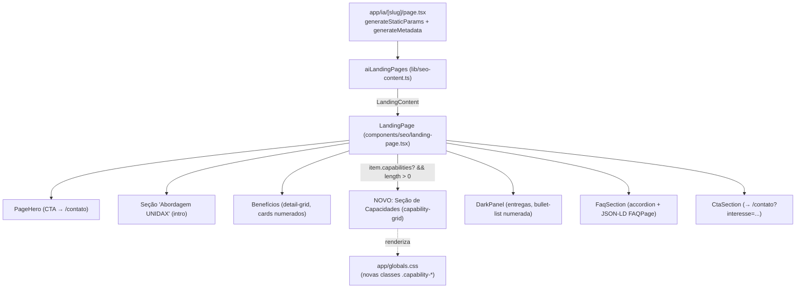

# Design Document — Enriquecimento da Página de Desenvolvimento de IA

## Overview

Este design descreve o enriquecimento da landing page `/ia/desenvolvimento-de-sistemas-de-ia` com conteúdo adaptado do site atual (`/servicos/desenvolvimento/`), recastado inteiramente no contexto de **desenvolvimento de sistemas de IA**. O objetivo é tornar a página mais rica e atraente, apresentando as capacidades específicas de engenharia de IA da UNIDAX, sem duplicar o conteúdo da página `/servicos/desenvolvimento-de-sistemas` (software genérico) e sem perder as características do layout atual — cards numerados de benefícios, `DarkPanel` de entregas, FAQ em accordion e CTA final.

A mudança é intencionalmente **de baixo raio de impacto**: o tipo compartilhado `LandingContent` recebe um novo campo *opcional* (`capabilities?`), o componente `LandingPage` renderiza uma nova seção apenas quando esse campo está presente e não vazio, e todo o CSS novo é adicionado em `app/globals.css`. As demais 8 landing pages (2 de IA + 6 de serviços) permanecem inalteradas e continuam renderizando sem mudança.

### Escopo

- **Alterado:** `lib/seo-content.ts` (tipo `LandingContent` + entrada `desenvolvimento-de-sistemas-de-ia`)
- **Alterado:** `components/seo/landing-page.tsx` (renderização condicional da nova seção)
- **Alterado:** `app/globals.css` (novas classes de CSS para capacidades)
- **Inalterado:** `app/ia/[slug]/page.tsx`, `components/page-hero.tsx`, `components/dark-panel.tsx`, `components/cta-section.tsx`, `components/seo/json-ld.tsx`, `components/reveal.tsx`, e todas as demais landing pages.

### Decisões principais (com rationale)

| # | Decisão | Rationale |
|---|---|---|
| D1 | `capabilities` é **opcional** (`?`) em `LandingContent` | Compatibilidade retroativa com as 9 landing pages existentes (Req 7.7). Páginas sem o campo continuam idênticas. |
| D2 | Seção de capacidades renderizada **inline** em `LandingPage` (sem novo componente) | Mantém o componente como Server Component, evita novos arquivos, reutiliza `Reveal`. Escopo mínimo. |
| D3 | Reutilizar `.detail-grid` (grid responsivo) e **estender** com `.capability-card` | `.detail-grid` já colapsa para 1 coluna em `max-width:700px`, satisfazendo Req 2.5 automaticamente. O novo `.capability-card` estende `.detail-card` com um acento visual superior, distinguindo capacidades dos benefícios. |
| D4 | Posicionar capacidades **entre benefícios e `DarkPanel`** | Conforme Req 2.1. Fluxo narrativo: por que escolher → o que construímos → como entregamos. |
| D5 | Manter o `<h2>` compartilhado "Começar pelo desafio..." na seção "Abordagem UNIDAX" | Não tornar o título configurável por página ( Req 1.3 pede apenas preservar a seção como contêiner). Apenas o campo `intro` é enriquecido — mudança mínima, 9 páginas intactas. |
| D6 | Entregas expandidas para 6 itens (adiciona governança/qualidade + operação contínua/MLOps) | Req 4.2 pede pelo menos 2 entregas adicionais sobre qualidade/governança e operação contínua. Numeração sequencial já tratada pelo componente. |
| D7 | FAQs expandidos para 6, focados em IA | Req 5.1 pede pelo menos 5. JSON-LD `FAQPage` e accordion acessível já existem no `FaqSection`. |
| D8 | Sem PBT — omitir Correctness Properties | O recurso é UI rendering + modelagem de dados + configuração; não há função pura com espaço de entrada amplo (ver Testing Strategy). |

## Architecture

A landing page `/ia/[slug]` é uma página estática (App Router) que lê dados diretamente de `lib/seo-content.ts` — **não** passa por `lib/cms.ts` (landing pages SEO são conteúdo tipado estático, diferente de cases/insights). O fluxo de dados é server-side e o componente `LandingPage` é um Server Component puro.



### Camadas envolvidas

1. **Dados (`lib/seo-content.ts`)** — fonte única de verdade para landing pages SEO. O tipo `LandingContent` é estendido com `capabilities?`. Apenas a entrada `desenvolvimento-de-sistemas-de-ia` recebe o novo campo; as demais permanecem sem alteração.
2. **Componente (`components/seo/landing-page.tsx`)** — Server Component que recebe `item: LandingContent` e renderiza as seções. A nova seção é condicional: renderiza apenas se `item.capabilities` existir e tiver ao menos 1 item. Reutiliza `Reveal` para animação de entrada.
3. **Apresentação (`app/globals.css`)** — novas classes CSS usam as mesmas custom properties e padrões visuais existentes. A responsividade mobile é herdada da reutilização do grid.

### Princípios respeitados

- **Server Components são o padrão**: `LandingPage` permanece sem `"use client"`. A única parte client é `Reveal` (já existente), isolada.
- **Toda CSS em `globals.css`**: nenhum arquivo CSS novo, sem CSS-in-JS, sem utility classes.
- **Texto em pt-BR**: todo conteúdo novo é em pt-BR.
- **Caminho de conversão preservado**: `PageHero` (CTA → `/contato`) e `CtaSection` final (→ `/contato?interesse=...`) não são alterados.

## Components and Interfaces

### `LandingPage` (Server Component) — `components/seo/landing-page.tsx`

Assinatura **inalterada**:

```ts
export function LandingPage({ item, kind }: { item: LandingContent; kind: "ia" | "servicos" })
```

A única mudança é a adição de um bloco de renderização condicional entre a seção de benefícios e o `DarkPanel`:

```tsx
{item.capabilities && item.capabilities.length > 0 && (
  <section className="section">
    <div className="container">
      <Reveal>
        <div className="eyebrow">Capacidades de IA</div>
        <h2>O que construímos em sistemas de IA.</h2>
        <p className="content-intro">...</p>
      </Reveal>
      <div className="capability-grid detail-grid">
        {item.capabilities.map((cap, index) => (
          <Reveal key={cap.title} delay={index * 70}>
            <article className="capability-card detail-card">
              <span className="number">0{index + 1}</span>
              <h3>{cap.title}</h3>
              <p>{cap.text}</p>
            </article>
          </Reveal>
        ))}
      </div>
    </div>
  </section>
)}
```

Notas de implementação:
- O guard `item.capabilities && item.capabilities.length > 0` satisfaz Req 2.6 (omitir sem erros quando ausente/vazio).
- Reutiliza `.detail-grid` (responsividade) e `.number` (numeração), estendendo o card com `.capability-card` para o acento visual.
- `Reveal` (Client Component) é usado exatamente como nas seções existentes — sem introduzir nova interatividade.
- O `<h2>` e o parágrafo de introdução da seção são literais pt-BR (não dados), pois a seção é específica de IA e só renderiza quando `capabilities` existe.

### Nenhum novo componente ou dependência

- Não há novos arquivos em `components/`.
- Não há novas dependências em `package.json`.
- `icons.tsx` **não é usado** — o modelo de dados de capacidades é `{ title: string; text: string }[]` (Req 2.2), sem ícone.

## Data Models

### Tipo `LandingContent` — `lib/seo-content.ts`

Adição de um único campo opcional:

```ts
export type LandingContent = {
  slug: string;
  title: string;
  h1: string;
  description: string;
  eyebrow: string;
  intro: string;
  benefits: { title: string; text: string }[];
  deliverables: string[];
  faqs: { question: string; answer: string }[];
  cta: string;
  serviceType: string;
  // NOVO — opcional: capacidades específicas. Omitido nas páginas que não usam.
  capabilities?: { title: string; text: string }[];
};
```

- O `?` torna o campo opcional. As 9 landing pages existentes não precisam declará-lo (TypeScript permite omitir propriedades opcionais) — Req 7.7 satisfeito.
- O componente trata `undefined` e array vazio de forma idêntica (ambos omitem a seção) — Req 2.6.

### Conteúdo enriquecido — entrada `desenvolvimento-de-sistemas-de-ia`

Os campos existentes (`slug`, `title`, `h1`, `eyebrow`, `description`, `cta`, `serviceType`) são **mantidos**. Os campos enriquecidos são `intro`, `deliverables`, `faqs` e o novo `capabilities`. Os `benefits` são mantidos (Req 3.1, Req 3.2).

**`intro` (enriquecida — Req 1):**

> Transformamos ideias e necessidades de negócio em sistemas de IA que funcionam em produção. Da descoberta do caso de uso à arquitetura, do piloto à operação contínua, conectamos modelos, dados, agentes e sistemas existentes com critérios claros de qualidade, segurança e governança.

Adapta "Transformamos ideias em realidades digitais" (site atual) ao contexto de IA, mantendo modelos, dados, agentes e automação inteligente (Req 1.2), dentro da seção "Abordagem UNIDAX" preservada (Req 1.3).

**`benefits` (mantidos — Req 3):** Aderência ao negócio, Integração com sistemas, Pronta para evoluir. (3 cards numerados, sem alteração.)

**`capabilities` (novo — Req 2):** 6 capacidades focadas em IA, cada uma com título e descrição. Estes são os tipos de **sistemas de IA** que a UNIDAX desenvolve — distintos das capacidades genéricas de software da `Página_Servicos_Dev` (Req 6):

1. **Aplicações com IA integrada** — sistemas que combinam interfaces, regras de negócio e modelos de IA (generativos, classificação, busca semântica) em um produto coerente e usável.
2. **Portais de conhecimento inteligentes** — portais e buscas baseadas em RAG que conectam colaboradores a documentos, manuais e bases internas, com contexto, permissões e atualização controlada.
3. **Arquitetura de sistemas de IA** — desenho de arquitetura escalável: orquestração de modelos, pipelines de dados, cache, observabilidade, fallbacks e limites de autonomia.
4. **Integração de IA com sistemas corporativos** — conexão de modelos e agentes a ERPs, CRMs e aplicações via APIs, com segurança, permissões mínimas e tratamento de dados.
5. **Avaliação de qualidade e governança de IA** — critérios de avaliação, métricas, supervisão humana, limites de autonomia, auditoria e tratamento de dados sensíveis.
6. **Operação contínua de IA (MLOps)** — monitoramento, reavaliação de qualidade, re-treinamento, gestão de versões de modelo e evolução contínua em produção.

Não duplicam "desenvolvimento de sistemas sob medida genérico" nem "outsourcing de squads" (cobertos pela `Página_Servicos_Dev`) — Req 6.2.

**`deliverables` (ampliadas — Req 4):** 6 etapas, mantendo descoberta, arquitetura, piloto e integração, e adicionando governança/qualidade e operação contínua. Numeração sequencial tratada pelo componente:

1. Descoberta e definição do caso de uso
2. Arquitetura técnica e avaliação de dados
3. Protótipo ou piloto com critérios de sucesso
4. Integração, testes e plano de operação
5. Avaliação de qualidade, métricas e governança de IA *(novo — Req 4.2)*
6. Operação contínua, monitoramento e evolução (MLOps) *(novo — Req 4.2)*

**`faqs` (ampliadas — Req 5):** 6 perguntas focadas em desenvolvimento de sistemas de IA (≥5, Req 5.1). O `FaqSection` gera JSON-LD `FAQPage` (Req 5.2) e mantém o accordion `details`/`summary` acessível (Req 5.3) sem alteração:

1. Que tipo de sistema de IA a UNIDAX pode desenvolver?
2. É possível integrar IA aos sistemas existentes?
3. Como controlar qualidade e risco?
4. Quanto tempo leva para colocar um sistema de IA em produção?
5. O que acontece depois que o sistema de IA entra em operação?
6. A UNIDAX trabalha com modelos open source e proprietários?

As respostas (a serem redigidas na fase de tarefas) permanecerão focadas em IA — modelos, dados, governança, MLOps — nunca em desenvolvimento de software genérico (Req 6.1).

## Error Handling

A mudança introduz pouca superfície de erro porque toda a lógica nova é **condicional e defensiva por construção**:

- **`capabilities` ausente ou vazio** — o guard `item.capabilities && item.capabilities.length > 0` omite a seção inteira. Nenhum erro de runtime, nenhuma marcação órfã. Isto cobre: (a) as 8 landing pages que não declaram o campo, e (b) o caso hipotético de um array vazio. (Req 2.6)
- **Type safety (strict)** — o campo é opcional e tipado; acessos via `.map` só ocorrem dentro do guard, então TypeScript não infere `undefined`. Sem `any`, sem `ts-ignore` (regra do projeto).
- **Numeração** — `0{index + 1}` produz `01`–`06` para 6 capacidades e 6 entregas. Funciona corretamente para até 9 itens; os volumes previstos (≤8 capacidades, ≤9 entregas) estão dentro do limite. Nenhum item excede 9.
- **Fallback de CMS** — esta página **não** depende de `lib/cms.ts` nem de Sanity; lê diretamente de `lib/seo-content.ts`. Logo, a cadeia de fallback (Sanity → `content.ts`) não se aplica aqui. O conteúdo é estático e sempre disponível.
- **Build/lint** — nenhuma nova dependência, nenhuma nova importação circular. `check:routes` não é afetado (não há mudança na estrutura de arquivos de rota — Req 7.3).

## Testing Strategy

### Por que PBT não se aplica

Avaliação formal conforme o guia do workflow:

- **UI rendering e layout** — a nova seção é marcação JSX renderizada condicionalmente. PBT é explicitamente inadequado para UI; usa-se inspeção visual/snapshot.
- **Configuração / modelagem de dados** — adicionar um campo opcional a um tipo não tem comportamento variando com entrada. É um caso de verificação de schema/tipo, não de propriedade universal.
- **Conteúdo estático** — strings pt-BR são dados, não lógica.

Não há declaração "para toda entrada X, P(X) vale" significativa aqui. Logo, o design omite a seção de Correctness Properties e a estratégia se apoia em verificação estática + build + inspeção.

### Verificação disponível no projeto

O projeto **não possui framework de teste** (sem Jest/Vitest em `package.json`). A estratégia usa as ferramentas reais do projeto, que já compõem a sequência de pré-deploy:

| Verificação | Comando | O que valida |
|---|---|---|
| Tipagem | `npm run typecheck` | `LandingContent` compatível com as 9 páginas (Req 7.7); sem `any`/`ts-ignore`. |
| Lint | `npm run lint` | Estilo/código em `app/`, `components/`, `lib/` (Req 7.3). |
| Build | `npm run build` | Compilação sem erros de TS; páginas estáticas geradas (Req 7.3, 7.4). |
| Rotas | `npm run check:routes` | Consistência entre arquivos de página e catálogos de slug — não deve regredir. |

### Casos de inspeção manual (visuais e funcionais)

Estes são os exemplos concretos que validam os critérios de aceitação não automatizáveis por build:

1. **Renderização condicional (Req 2.6)** — abrir `/ia/desenvolvimento-de-sistemas-de-ia` (deve mostrar a seção de capacidades) e abrir `/ia/consultoria-estrategica-em-ia` (não deve mostrar a seção, pois não declara `capabilities`). Confirma que a omissão não gera erros.
2. **Conteúdo de capacidades (Req 2.2, 2.3)** — verificar ≥5 capacidades com título e descrição, focadas em IA.
3. **Responsividade (Req 2.5)** — em viewport ≤700px, capacidades em coluna única, sem truncamento de texto (herdado do `.detail-grid`).
4. **Benefícios preservados (Req 3.1, 3.2)** — 3 cards numerados mantidos.
5. **Entregas ampliadas (Req 4.1, 4.2, 4.3)** — 6 itens no `DarkPanel`, numeração sequencial `01`–`06`, incluindo governança/qualidade e operação contínua.
6. **FAQs ampliados (Req 5.1, 5.2, 5.3)** — ≥5 perguntas; inspecionar o JSON-LD `FAQPage` no DOM (script `application/ld+json`); confirmar accordion `details`/`summary`.
7. **Não duplicação (Req 6)** — comparar texto desta página com `/servicos/desenvolvimento-de-sistemas`: nenhum tópico de app móvel genérico, website, fábrica de software convencional ou outsourcing de squads.
8. **Caminho de conversão (Req 7.1, 7.2)** — CTA do `PageHero` → `/contato`; `CtaSection` final → `/contato?interesse=Desenvolvimento%20de%20sistemas%20de%20IA`.
9. **pt-BR (Req 7.6)** — nenhum texto em inglês exibido.

### Sequência de verificação recomendada (pós-implementação)

```bash
npm run check:routes
npm run typecheck
npm run lint
npm run build
```

Após o build, rodar `npm run dev` e percorrer manualmente os 9 itens de inspeção acima (a sequência de dev deve ser executada manualmente pelo usuário, pois é um processo de longa duração).
