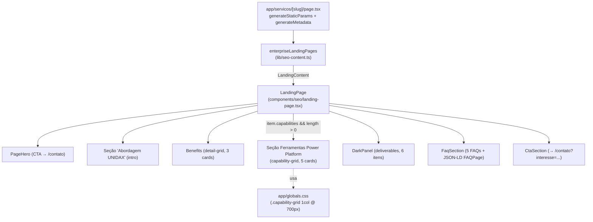

# Design Document — Enriquecimento da Página Microsoft Power Platform

## Overview

Este design descreve as mudanças necessárias para enriquecer a landing page `/servicos/power-platform` com conteúdo específico sobre as cinco ferramentas da Microsoft Power Platform, cobrindo a abordagem consultiva da UNIDAX, expandindo entregáveis e FAQs, e garantindo responsividade correta da seção de capabilities em dispositivos móveis.

A mudança segue o padrão estabelecido pela spec `erp-dynamics-page-enrichment`: dados estáticos em `lib/seo-content.ts`, campos opcionais já disponíveis no tipo `LandingContent`, CSS em `globals.css`. O único delta em relação àquela spec é a ausência de alterações no componente — os campos `capabilitiesEyebrow?` e `capabilitiesTitle?` já foram adicionados ao tipo, e o componente já usa `??` como fallback. A única lacuna identificada é a regra CSS mobile para `.capability-grid` no breakpoint `max-width: 700px`.

### Escopo

| Arquivo | Tipo de mudança |
|---|---|
| `lib/seo-content.ts` | Entrada `power-platform`: todos os campos de conteúdo revisados/expandidos. O tipo `LandingContent` **não é alterado** — `capabilities?`, `capabilitiesEyebrow?` e `capabilitiesTitle?` já existem. |
| `app/globals.css` | Adicionar `.capability-grid { grid-template-columns: 1fr }` dentro do bloco `@media (max-width: 700px)` existente. |
| `components/seo/landing-page.tsx` | **Sem alterações** — eyebrow e h2 da seção capabilities já são configuráveis via `??` desde a spec de ERP/Dynamics. |

### Não alterado

Todos os demais arquivos permanecem intocados: `app/servicos/[slug]/page.tsx`, `components/page-hero.tsx`, `components/dark-panel.tsx`, `components/cta-section.tsx`, `components/seo/json-ld.tsx`, `components/reveal.tsx`, e todas as demais 8 landing pages (3 de IA + 5 de serviços enterprise).

### Decisões principais

| # | Decisão | Rationale |
|---|---|---|
| D1 | Tipo `LandingContent` **não é alterado** | Os campos opcionais `capabilities?`, `capabilitiesEyebrow?` e `capabilitiesTitle?` já foram adicionados pela spec `erp-dynamics-page-enrichment`. Reabrir o tipo seria retrabalho desnecessário e poderia introduzir conflito. |
| D2 | Componente `LandingPage` **não é alterado** | O fallback `item.capabilitiesEyebrow ?? "Capacidades de IA"` e `item.capabilitiesTitle ?? "O que construímos em sistemas de IA."` já estão no componente. Declarar os campos na entrada `power-platform` é suficiente para sobrescrever os valores-padrão. |
| D3 | Regra CSS adicionada **dentro do bloco `@media (max-width: 700px)` já existente** | Sem novos blocos `@media`, sem novos arquivos CSS. A regra `.capability-grid { grid-template-columns: 1fr }` supre a lacuna identificada no Requirement 3.7. |
| D4 | `@media (max-width: 1020px)` não recebe regra adicional para `.capability-grid` | A grid de capabilities usa a classe `capability-grid detail-grid`. O bloco `max-width: 1020px` já inclui `.detail-grid { grid-template-columns: 1fr }` que cobre o fallback tablet; os 5 cards de capabilities ficam em 1 coluna em tablet — adequado ao volume menor de items (5 vs. 6 no ERP/Dynamics). |
| D5 | Sem PBT — seção Correctness Properties omitida | A mudança é modelagem de dados estáticos + uma regra CSS. Toda verificação dos acceptance criteria é do tipo EXAMPLE ou SMOKE: contagem de itens em arrays estáticos, verificação de strings, inspeção de regra CSS. Não existe função pura com espaço de entrada amplo onde 100 iterações encontrariam mais bugs que 2–3 exemplos concretos. |

## Architecture

A landing page `/servicos/power-platform` é uma página estática do App Router que lê dados diretamente de `lib/seo-content.ts` — não passa por `lib/cms.ts`. O fluxo é idêntico ao da página de ERP/Dynamics.



### Camadas envolvidas

1. **Dados (`lib/seo-content.ts`)** — fonte única de verdade para landing pages SEO. A entrada `power-platform` é reescrita integralmente; o tipo `LandingContent` não é tocado.
2. **Apresentação (`app/globals.css`)** — uma regra adicionada dentro do bloco `@media (max-width: 700px)` existente.
3. **Componente (`components/seo/landing-page.tsx`)** — sem alterações; já suporta os campos `capabilitiesEyebrow?` e `capabilitiesTitle?` com fallback via `??`.

### Princípios respeitados

- **Server Components são o padrão**: `LandingPage` continua sem `"use client"`.
- **Toda CSS em `globals.css`**: nenhum arquivo CSS novo, sem CSS-in-JS.
- **Todo texto em pt-BR**: nomes de produtos Microsoft mantidos conforme nomenclatura oficial.
- **Caminho de conversão preservado**: `PageHero` e `CtaSection` não são alterados.

## Components and Interfaces

### `LandingPage` (Server Component) — `components/seo/landing-page.tsx`

**Sem alterações.** O componente já renderiza os campos `capabilitiesEyebrow` e `capabilitiesTitle` com fallback:

```tsx
<div className="eyebrow">{item.capabilitiesEyebrow ?? "Capacidades de IA"}</div>
<h2>{item.capabilitiesTitle ?? "O que construímos em sistemas de IA."}</h2>
```

Ao declarar `capabilitiesEyebrow: "Ferramentas Power Platform"` e `capabilitiesTitle: "Uma plataforma integrada para aplicações, automação e dados empresariais."` na entrada `power-platform`, o componente renderizará os valores corretos sem nenhuma modificação.

### Nenhum novo componente ou dependência

Não há novos arquivos em `components/`, `lib/` ou `app/`. Sem novas dependências em `package.json`.

## Data Models

### Tipo `LandingContent` — sem alterações

O tipo já contém todos os campos necessários:

```ts
export type LandingContent = {
  slug: string;
  title: string;
  h1: string;
  description: string;
  eyebrow: string;
  intro: string;
  benefits: { title: string; text: string }[];
  deliverables: string[];
  faqs: { question: string; answer: string }[];
  cta: string;
  serviceType: string;
  capabilities?: { title: string; text: string }[];
  capabilitiesEyebrow?: string;
  capabilitiesTitle?: string;
};
```

### Conteúdo reescrito — entrada `power-platform`

Os campos `slug`, `eyebrow`, `cta` e `serviceType` são mantidos. Todos os demais campos são reescritos conforme os requisitos.

**`title`** (mantido): `"Microsoft Power Platform"`

**`h1`** (Req 1.1 — contém "Microsoft Power Platform" + "governança"):
> `"Microsoft Power Platform: aplicações, automação e dados com governança"`

**`description`** (Req 1.2 — referencia low-code, automação e dados; três dos quatro temas obrigatórios):
> `"Consultoria e implementação de Microsoft Power Platform para desenvolver aplicações low-code, automatizar processos e analisar dados — integrado ao ecossistema Microsoft."`

**`intro`** (Req 1.3 — 2 frases; menciona as 5 ferramentas, unificação, integração, sustentabilidade; sem adjetivos subjetivos):
> `"O Microsoft Power Platform reúne cinco ferramentas integradas — Power Apps, Power Automate, Power Pages, Power BI e Copilot Studio — para que empresas criem aplicações, automatizem processos, publiquem portais, analisem dados e operem assistentes virtuais no mesmo ecossistema. A UNIDAX atua na implementação, configuração e governança dessas ferramentas com atenção aos processos reais, às integrações com sistemas existentes e à sustentabilidade das soluções no ambiente do cliente."`

**`benefits`** (Req 2 — 3 cards; temas: avaliação do processo antes de automatizar, integração com ecossistema Microsoft, governança desde o início):

| # | Título | Texto |
|---|---|---|
| 01 | Avaliação antes de automatizar | Mapeamos volume, frequência e estabilidade das regras do processo para identificar o que vale automatizar e onde a complexidade supera o benefício. |
| 02 | Integração com o ecossistema existente | Consideramos conexões com Microsoft 365, Dynamics 365, SharePoint e fontes de dados internas para que a solução se encaixe no ambiente sem criar dependências frágeis. |
| 03 | Governança desde o início | Definimos ambientes, políticas de acesso, ciclo de vida das soluções e plano de sustentação antes de colocar qualquer fluxo em produção. |

**`capabilitiesEyebrow`** (Req 3.2 — valor exato):
> `"Ferramentas Power Platform"`

**`capabilitiesTitle`** (Req 3.3 — 9 palavras; menciona Power Platform + "aplicações", "automação" e "dados"):
> `"Uma plataforma integrada para aplicações, automação e dados empresariais."`

**`capabilities`** (Req 3 — 5 ferramentas em ordem; nome oficial como `title`; `text` com 1–3 frases de resultado mensurável):

| # | Título | Texto |
|---|---|---|
| 01 | Power Apps | Crie aplicações personalizadas para web e mobile sem programação avançada, conectando dados do Microsoft 365, Dynamics 365, SQL Server e Dataverse para digitalizar operações específicas do negócio. |
| 02 | Power Automate | Automatize aprovações, notificações e sincronização de dados entre sistemas, incluindo automação robótica de processos para tarefas que envolvem aplicações legadas sem API. |
| 03 | Power Pages | Publique portais web seguros e responsivos conectados ao Dataverse e a serviços corporativos — para autoatendimento de clientes, gestão de parceiros ou comunidades internas. |
| 04 | Power BI | Transforme dados de múltiplas fontes em relatórios e painéis interativos, com monitoramento de KPIs em tempo real e integração nativa com Azure, SQL Server e Excel. |
| 05 | Copilot Studio | Crie assistentes virtuais com IA generativa integrados ao Microsoft 365 e ao Dynamics 365, com fluxos de automação e respostas baseadas em fontes de dados do negócio. |

**`deliverables`** (Req 4 — exatamente 6 itens em ordem; cada item entre 3 e 12 palavras):

1. Mapeamento de processos e identificação de oportunidades
2. Seleção de ferramentas e proposta de solução
3. Implementação e configuração das ferramentas selecionadas
4. Validação com usuários e ajustes de fluxo
5. Orientação para governança de ambientes e políticas de acesso
6. Sustentação e evolução das soluções implantadas

**`faqs`** (Req 5 — 5 perguntas cobrindo os cinco temas obrigatórios):

| # | Pergunta | Tema |
|---|---|---|
| 1 | Como escolher a ferramenta certa da Power Platform para cada necessidade? | (a) escolha de ferramenta |
| 2 | A Power Platform integra com Dynamics 365 e outros sistemas Microsoft? | (b) integração com ecossistema |
| 3 | Como funciona o licenciamento da Power Platform? | (c) modelo de licenciamento |
| 4 | Quando faz mais sentido usar Power Platform do que desenvolver um sistema customizado? | (d) PP vs. desenvolvimento customizado |
| 5 | Como garantir governança e segurança no uso da Power Platform? | (e) governança e controle de ambientes |

As respostas serão redigidas na fase de tarefas, com linguagem direta, honesta e ao menos uma afirmação verificável por resposta (Req 5.3).

**`cta`** (mantido): `"Identificar automações"`

### CSS — `app/globals.css`

Adicionar dentro do bloco `@media (max-width: 700px)` existente (Req 3.7):

```css
.capability-grid { grid-template-columns: 1fr; }
```

**Contexto da regra:** A classe `capability-grid` já aparece junto a `detail-grid` no componente (`<div className="capability-grid detail-grid">`). O bloco `@media (max-width: 700px)` existente contém regras para `.detail-grid`, `.problem-grid`, `.service-grid` e outros grids, mas não para `.capability-grid` explicitamente. Sem essa regra, os 5 cards de capabilities poderiam ser renderizados em layout inadequado em mobile. A regra deve ser inserida no bloco `@media (max-width: 700px)` já existente, sem criar um novo bloco `@media`.

## Error Handling

A superfície de erro desta mudança é pequena — toda lógica condicional já existe e é defensiva no componente:

- **`capabilitiesEyebrow` / `capabilitiesTitle` declarados** — o componente usa `??`; ao declarar os valores na entrada, o `??` passa diretamente o valor sem risco de runtime.
- **`capabilities` com 5 itens** — o guard `item.capabilities && item.capabilities.length > 0` (já existente no componente) omite a seção inteira se ausente ou vazio. Com 5 itens declarados, a seção é exibida corretamente.
- **Numeração `0{index + 1}`** — funciona corretamente para até 9 itens. 5 capabilities e 6 deliverables estão dentro do limite sem overflow.
- **Type safety (strict)** — todos os campos novos na entrada são strings ou arrays de objetos tipados; TypeScript strict mode valida em `npm run typecheck`. Sem `any`, sem `ts-ignore`.
- **Fallback de CMS** — `lib/seo-content.ts` é conteúdo estático; `lib/cms.ts` não está envolvido. A cadeia de fallback Sanity → `content.ts` não se aplica.
- **Regra CSS isolada** — a adição dentro de um bloco `@media` existente não pode conflitar com outras regras; `.capability-grid` não possui definição prévia neste breakpoint.
- **Build/lint** — nenhuma nova dependência, nenhuma nova importação. `npm run check:routes` não é afetado (nenhuma mudança na estrutura de arquivos de rota).

## Testing Strategy

### Por que PBT não se aplica

Avaliação formal conforme o guia do workflow:

- **Modelagem de dados estáticos** — reescrever um objeto de conteúdo em `lib/seo-content.ts`. Verificação é de tipo e conteúdo específico, não de propriedade universal.
- **Regra CSS** — adicionar uma regra responsiva dentro de um bloco `@media` existente. Não há comportamento variando com entradas.
- **UI rendering** — o componente `LandingPage` não é alterado; a renderização é de marcação JSX determinística a partir de dados estáticos.

Nenhum acceptance criterion produz uma declaração "para toda entrada X, P(X) vale" significativa. Todos os critérios são do tipo EXAMPLE ou SMOKE. O design omite a seção de Correctness Properties.

### Verificação disponível no projeto

O projeto não possui framework de testes (sem Jest/Vitest em `package.json`). A estratégia usa a sequência pré-deploy real:

| Verificação | Comando | O que valida |
|---|---|---|
| Rotas | `npm run check:routes` | Consistência entre arquivos de página e catálogos de slug — não deve regredir. |
| Tipagem | `npm run typecheck` | Entrada `power-platform` compatível com `LandingContent`; campos opcionais respeitados. |
| Lint | `npm run lint` | Estilo/código em `app/`, `components/`, `lib/`. |
| Build | `npm run build` | Compilação sem erros de TS; páginas estáticas geradas para todos os slugs. |

### Casos de inspeção manual

Estes exemplos concretos validam os acceptance criteria não automatizáveis por build:

1. **h1 (Req 1.1)** — abrir `/servicos/power-platform` e confirmar que o `<h1>` contém "Microsoft Power Platform" e "governança".
2. **description (Req 1.2)** — verificar que a `description` referencia ao menos 3 dos 4 temas: low-code, automação, dados, IA.
3. **intro (Req 1.3)** — verificar que o intro tem 2 frases, descreve a proposta de valor de unificação das 5 ferramentas, sem adjetivos subjetivos ("moderno", "intuitivo", "robusto").
4. **Benefits (Req 2)** — 3 cards numerados cobrindo: (a) avaliação do processo, (b) integração com ecossistema Microsoft, (c) governança desde o início; títulos com complemento mensurável.
5. **capabilitiesEyebrow (Req 3.2)** — confirmar que o eyebrow da seção exibe exatamente "Ferramentas Power Platform".
6. **capabilitiesTitle (Req 3.3)** — confirmar que o `<h2>` exibe "Uma plataforma integrada para aplicações, automação e dados empresariais."
7. **Capabilities — 5 ferramentas (Req 3.1 e 3.5)** — 5 cards numerados em ordem: Power Apps, Power Automate, Power Pages, Power BI, Copilot Studio; nomes oficiais Microsoft; textos com resultados mensuráveis; sem repetição de trechos do intro ou benefits.
8. **Responsividade mobile (Req 3.7)** — em viewport ≤700px, capabilities em 1 coluna; verificar que a regra `.capability-grid { grid-template-columns: 1fr }` está no bloco `@media (max-width: 700px)` em `globals.css`.
9. **Deliverables (Req 4)** — 6 itens no `DarkPanel` em ordem, cobrindo o ciclo completo; cada item entre 3 e 12 palavras; termos técnicos como "Power Apps" acompanhados de complemento descritivo em português.
10. **FAQs (Req 5)** — 5 perguntas cobrindo: escolha de ferramenta, integração com Dynamics 365, licenciamento, PP vs. custom dev, governança; accordion `details`/`summary` acessível via teclado; JSON-LD `FAQPage` no DOM.
11. **Fallback das demais landing pages (D2)** — abrir `/ia/desenvolvimento-de-sistemas-de-ia` e confirmar que o eyebrow continua "Capacidades de IA" e o `<h2>` continua "O que construímos em sistemas de IA." (fallback ativo para entrada sem `capabilitiesEyebrow`).
12. **pt-BR (Req 1.4)** — nenhum texto em inglês exibido ao usuário; nomes de produtos Microsoft mantidos conforme nomenclatura oficial.
13. **Caminho de conversão** — `PageHero` CTA → `/contato`; `CtaSection` → `/contato?interesse=Microsoft%20Power%20Platform`.

### Sequência de verificação recomendada (pós-implementação)

```bash
npm run check:routes
npm run typecheck
npm run lint
npm run build
```

Após o build, executar `npm run dev` manualmente (processo de longa duração) e percorrer os 13 itens de inspeção acima.
